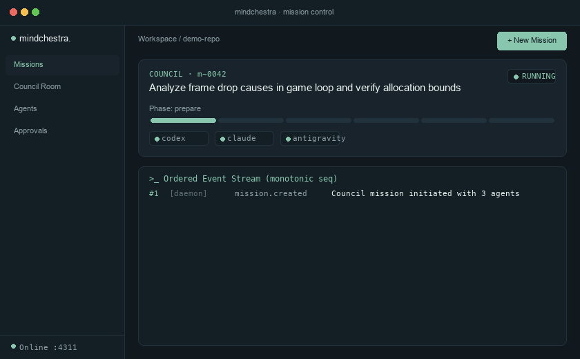

<div align="center">
  
  <h1>mindchestra.</h1>
  <p><strong>Many minds. One conductor.</strong></p>
  <p>A local-first, multi-agent AI and Model Context Protocol (MCP) orchestration framework.</p>

  <p>
    <a href="#quickstart"></a>
    <a href="#quickstart"></a>
    <a href="#tests"></a>
    <a href="LICENSE"></a>
  </p>
</div>

---

<div align="center">
  
</div>

---

## What is Mindchestra?

Mindchestra unites diverse AI coding agents (Codex, Claude Code, Antigravity, local LLMs) and authorized MCP tools around a single objective with strict runtime boundaries, deterministic replay, and cryptographic verification.

* **Blind-then-Critique**: Agents formulate initial findings in complete isolation. Only after phase barriers are satisfied are claims shared for cross-examination.
* **Evidence & Verdict**: Majority voting does not guarantee truth. Claims must bind real test outputs, artifact SHA-256 hashes, or profiler logs to earn verification.
* **Default-Deny Policy**: Tools require explicit, scoped grants. Actions are fingerprinted with SHA-256 canonical JSON `actionHash` before execution.
* **Monotonic Append-Only Events**: Daemon assigns monotonic sequence numbers (`seq`), timestamps, and correlation IDs to every emitted event.

---

## Monorepo Architecture

```
mindchestra/
├── apps/
│   ├── daemon/          # Fastify loopback HTTP/SSE API (:4311)
│   ├── cli/             # Developer CLI (doctor, ask, agents, status)
│   └── web/             # Minimalist React + Vite dashboard
│
├── packages/
│   ├── contracts/       # Canonical frozen Zod contracts & types (v1)
│   ├── core/            # Mission engine, mailbox, scheduler & verdict
│   ├── storage/         # SQLite WAL event store & content-addressed artifacts
│   ├── policy/          # SSRF guard, action hashing & secret redaction
│   ├── mcp-server/      # Upstream stdio facade
│   ├── mcp-gateway/     # Downstream client gateway
│   ├── adapter-sdk/     # Provider-independent adapter SDK & conformance harness
│   └── adapters/        # Deterministic mock adapter & provider registry
│
├── tests/               # Contract, core, security, integration, and adapter tests
└── examples/            # Minimal custom adapter implementation templates
```

---

## Quickstart

### Prerequisites
* **Node.js**: `>= 22.0.0`
* **pnpm**: `>= 11.5.0`

### Installation

```bash
# Clone repository
git clone https://github.com/TwoBit-Dev/Mindchestra.git
cd Mindchestra

# Install dependencies across workspace
pnpm install

# Build all packages
pnpm build

# Run full test suite (41 unit, contract, security, and integration tests)
pnpm test
```

---

## Running the Web Dashboard

Mindchestra includes a lightweight, professional developer dashboard built with React 19, Vite, and Tailwind CSS v4:

```bash
pnpm --filter @mindchestra/web dev
```

Open **[http://127.0.0.1:5173](http://127.0.0.1:5173)** in your browser to inspect active missions, observe monotonic event streams, and review agent claims.

---

## Using the CLI

The `@mindchestra/cli` package provides diagnostic, dispatch, and inspection commands:

```bash
# Run system and provider environment diagnostics
node apps/cli/bin/mindchestra.js doctor

# Preview workspace configuration
node apps/cli/bin/mindchestra.js init --preview

# Dispatch a multi-agent Council mission
node apps/cli/bin/mindchestra.js ask "Analyze frame drops in render loop" --mode council

# Inspect running mission status
node apps/cli/bin/mindchestra.js status <missionId>
```

---

## Developing Custom AI Adapters

Mindchestra adapters decouple concrete provider APIs/CLIs from the orchestration engine. New providers implement `AgentAdapter` using `@mindchestra/adapter-sdk`:

```typescript
import { BaseAgentAdapter } from '@mindchestra/adapter-sdk';
import type { AdapterEvent, AgentManifest, ProbeResult, RunRequest } from '@mindchestra/contracts';

export class MyCustomAdapter extends BaseAgentAdapter {
  constructor() {
    super({
      id: 'custom-agent',
      displayName: 'My Custom Agent',
      provider: 'custom',
      adapterVersion: '0.1.0',
      sdkVersion: 1,
      kind: 'custom',
      capabilities: { streaming: true, tools: false, resume: false, steer: false, usage: true, vision: false, workspaceWrite: false, nativeSandbox: false, structuredOutput: false }
    });
  }

  async probe(signal: AbortSignal): Promise<ProbeResult> {
    return { status: 'ready', checkedAt: new Date().toISOString(), capabilities: this._manifest.capabilities };
  }

  async *run(req: RunRequest, signal: AbortSignal): AsyncIterable<AdapterEvent> {
    yield { type: 'agent.started', payload: {} };
    yield { type: 'message.completed', payload: { messageId: crypto.randomUUID(), text: 'Findings verified.' } };
    yield { type: 'agent.finished', payload: { summary: 'Analysis complete.' } };
  }
}
```

See [docs/guides/adapter-authoring.md](docs/guides/adapter-authoring.md) and [examples/custom-adapter](examples/custom-adapter) for complete examples and conformance testing instructions.

---

## License

Licensed under the [MIT License](LICENSE). Copyright © 2026 TwoBit Dev.
